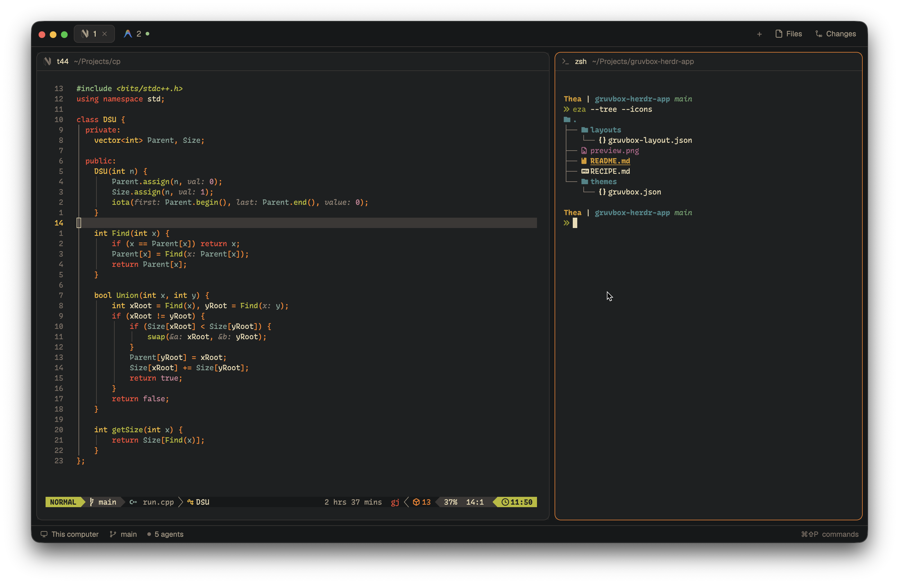

# gruvbox-herdr-app

Modernized Gruvbox suite and contrast switcher mod for [Herdr](https://herdr.dev), based on [gruvbox_v2.nvim](https://github.com/Codesmith28/gruvbox_v2.nvim).



Includes 3 contrast variations (hard, medium, soft) for both dark and light modes on Herdr's default layout, pure monochrome icons for AI models, and an interactive Gruvbox theme controller mod.

### Dark Mode
- **`gruvbox`** *(hard, default)* — Deep `#1d2021` buffer with `#161819` floats/sidebars.
- **`gruvbox-medium`** — Classic `#282828` buffer with `#212324` floats/sidebars.
- **`gruvbox-soft`** — Warm `#32302f` buffer with `#282828` floats/sidebars.

### Light Mode
- **`gruvbox-light`** *(hard, default)* — Crisp `#f9f5d7` buffer with `#ebdbb2` floats/sidebars.
- **`gruvbox-light-medium`** — Classic `#fbf1c7` buffer with `#f2e5bc` floats/sidebars.
- **`gruvbox-light-soft`** — Warm `#f2e5bc` buffer with `#ebdbb2` floats/sidebars.

## Installation

### Via Herdr Agent

In any Herdr terminal, prompt your agent:

```text
Add the Herdr mod from github.com/Codesmith28/gruvbox-herdr-app
```

The agent will read `RECIPE.md`, install the mod to `~/.config/herdr-app/mods/gruvbox`, merge the `keys.json` shortcut (`Ctrl+Alt+G`), and copy the theme files and monochrome icon assets directly into `~/.config/herdr-app/`.

### Manual Installation

#### 1. Themes & Mod

```sh
git clone https://github.com/Codesmith28/gruvbox-herdr-app.git
cp gruvbox-herdr-app/themes/*.json ~/.config/herdr-app/themes/
cp -r gruvbox-herdr-app/mods/gruvbox ~/.config/herdr-app/mods/
```

Merge the shortcut from `keys.json` into your `~/.config/herdr-app/keys.json`:
```json
{
  "global": { "ctrl-alt-g": "mod.open:gruvbox" },
  "terminal": { "ctrl-alt-g": "mod.open:gruvbox" }
}
```

#### 2. Monochrome Icons (Optional)

By default, developer tools like Neovim, Vim, Git, and Shell use monochrome icons tinted to theme text colors, while AI model icons (Claude, Gemini, Antigravity, Codex, Amp, Crush, Kimi, Kiro, Pig) render in hardcoded brand colors.

Copy the monochrome icon assets and program definitions to unify all program icons as clean monochrome glyphs tinted by the active theme's foreground/muted text colors (pure monochrome without hardcoded colors):

```sh
cp -r gruvbox-herdr-app/icons-mono ~/.config/herdr-app/
cp gruvbox-herdr-app/programs.json ~/.config/herdr-app/
```

## Usage

### In-App Switcher (Mod)

Press **`Ctrl+Alt+G`** (or run `herdr-app do mod.open --name gruvbox`) to toggle the floating Gruvbox palette controller. Press `1` through `6` or click any variant to switch themes instantly.

### CLI

Apply any variant directly via CLI:

```sh
# Dark variants
herdr-app do app.theme --name gruvbox              # Hard (default)
herdr-app do app.theme --name gruvbox-medium       # Medium
herdr-app do app.theme --name gruvbox-soft         # Soft

# Light variants
herdr-app do app.theme --name gruvbox-light        # Hard (default)
herdr-app do app.theme --name gruvbox-light-medium # Medium
herdr-app do app.theme --name gruvbox-light-soft   # Soft
```

Or select your preferred variant in **Settings (`Cmd+,`) → Look**.

## Default Layout

All variations use Herdr's native semantic tokens (`canvas`, `background`, `surface`, `chrome`, `border`, `accent`, etc.) to style Herdr seamlessly on its default layout (`main`) without requiring custom layout overrides or modifying shipped layout files.

## License

[Apache-2.0](LICENSE)
