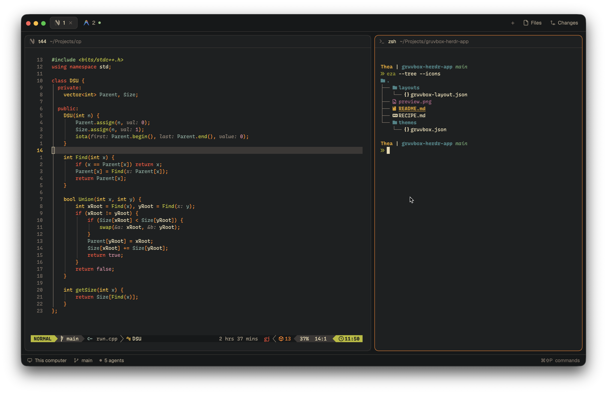

# Gruvbox

Modernized Gruvbox theme suite with 3 contrast variations (hard, medium, soft) across Dark and Light modes, paired with pure monochrome icons for AI models and an in-app Gruvbox palette controller to quickly switch contrast modes and preview colors.



This file is the brief: enough to build Gruvbox from an empty folder. The files next to it are one build of it. If they don't work on your Herdr, or you want it different, build it again from here.

## What you see

- A floating popup near the top of your window, 480px wide and 380px high, offset 64px from the top. No changes or custom files are added to the `layouts/` folder.
- A header: "Gruvbox Theme & Contrast" on the left, "1–6 switch · ↑/↓ navigate · Esc close" muted on the right.
- A list of the 6 Gruvbox variants:
  1. **Dark Hard** (`gruvbox`): Signature dark buffer (`#1d2021`) with `#161819` chrome.
  2. **Dark Medium** (`gruvbox-medium`): Medium dark buffer (`#282828`) with `#212324` chrome.
  3. **Dark Soft** (`gruvbox-soft`): Muted dark buffer (`#32302f`) with `#282828` chrome.
  4. **Light Hard** (`gruvbox-light`): High-contrast light buffer (`#f9f5d7`) with `#ebdbb2` chrome.
  5. **Light Medium** (`gruvbox-light-medium`): Balanced light buffer (`#fbf1c7`) with `#f2e5bc` chrome.
  6. **Light Soft** (`gruvbox-light-soft`): Soft light buffer (`#f2e5bc`) with `#ebdbb2` chrome.
- Each row displays its numeric hotkey (1–6) in an accent badge, the variant name, contrast label, a mini color palette bar showing the variant's buffer background and 7 signature Gruvbox accent colors, and an "Active" badge if that theme is currently running.
- Hover and selection highlight: subtle background highlight with a 1px Gruvbox accent border.
- A footer: Displays the currently active theme name and "Gruvbox Suite + Monochrome Icons".
- Across Herdr: In addition to the controller mod, the suite provides:
  - **Themes:** 6 clean Gruvbox JSON themes utilizing Herdr semantic tokens (`canvas`, `background`, `surface`, `border`, `accent`, etc.) on Herdr's default `main` layout.
  - **Monochrome Icons:** AI models (Claude, Gemini, Antigravity, Codex, Amp, Crush, Kimi, Kiro, Pig) render as clean monochrome vector glyphs tinted to the theme foreground/muted text color.

## How it behaves

- Pressing `Ctrl+Alt+G` (or running `herdr-app do mod.open --name gruvbox`) toggles the Gruvbox controller popup.
- Pressing `1` through `6` instantly applies that Gruvbox variant and closes the popup.
- `Up` and `Down` arrow keys navigate the list; `Enter` selects the active item and closes the popup.
- Hovering over an item highlights it; clicking it immediately switches to that theme and dismisses the popup.
- `Escape` cancels and closes the popup without changing the theme.
- Switching theme executes `run("app.theme", { name: variant.id })`, immediately updating the entire Herdr app interface, terminal chrome, sidebars, and buffers.
- AI agent status colors follow semantic Gruvbox tokens:
  - Dark mode: Yellow (`#fabd2f`) working, red (`#fb4934`) blocked, aqua (`#8ec07c`) done, gray (`#928374`) idle.
  - Light mode: Yellow (`#b57614`) working, red (`#9d0006`) blocked, blue (`#076678`) done, gray (`#928374`) idle.

## Built from

- **One mod**, `mods/gruvbox/`, with `main.js` and `mod.json`. Manifest has `place: "none"` and an overlay popup (`kind: "popup", at: "top", offset: 64, width: 480, height: 380`). There is **no `layouts/` folder**.
- **A `keys.json` snippet** with global and terminal shortcuts:
  ```json
  {
    "global": { "ctrl-alt-g": "mod.open:gruvbox" },
    "terminal": { "ctrl-alt-g": "mod.open:gruvbox" }
  }
  ```
- **Themes (`themes/`)**:
  - `themes/gruvbox.json` (Dark Hard)
  - `themes/gruvbox-medium.json` (Dark Medium)
  - `themes/gruvbox-soft.json` (Dark Soft)
  - `themes/gruvbox-light.json` (Light Hard)
  - `themes/gruvbox-light-medium.json` (Light Medium)
  - `themes/gruvbox-light-soft.json` (Light Soft)
- **Monochrome Icons (`icons-mono/` and `programs.json`)**:
  - Single-path SVG glyphs for Claude, Gemini, Antigravity, Codex, Amp, Crush, Kimi, Kiro, and Pig.
  - `programs.json` mapping each model with `"tint": true`.
- **Commands:** `app.theme`, dispatched via `run("app.theme", { name: variant.id })`, and overlay lifecycle via `closeOverlay(props().overlay)`.

## Watch out

- **No `layouts/` folder:** Do not create or edit any layout files (`layouts/*.json`). Doing so causes Herdr to generate unwanted `-edited` layouts (e.g. `terminals-edited.json`). This mod is designed to run directly on Herdr's default `main` layout.
- Color values in GPUI must be valid hex strings (e.g., `#00000000` for transparent) or semantic theme tokens, not CSS keywords like `transparent`.
- GPUI uses `hover((s) => s.bg(...))` for hover styles and `.on_click(...)` for click actions, rather than DOM event listeners.
- Terminal black (`ansi0`) is kept at `#3c3836` in dark themes rather than `#1d2021` so black terminal text remains visible against the buffer background.

## Done when

1. `herdr-app check mods/gruvbox` passes with code 0.
2. Theme files exist in `themes/` and install to `~/.config/herdr-app/themes/`.
3. All 6 variants switch cleanly without errors via `herdr-app do app.theme --name <name>`.
4. `Ctrl+Alt+G` or `herdr-app do mod.open --name gruvbox` opens the Gruvbox controller popup.
5. Pressing 1–6 or clicking a variant switches Herdr's theme live and closes the popup.
6. Escape dismisses the popup cleanly.
7. No `layouts/` directory exists in the repository, and Herdr status reports 0 errors.
